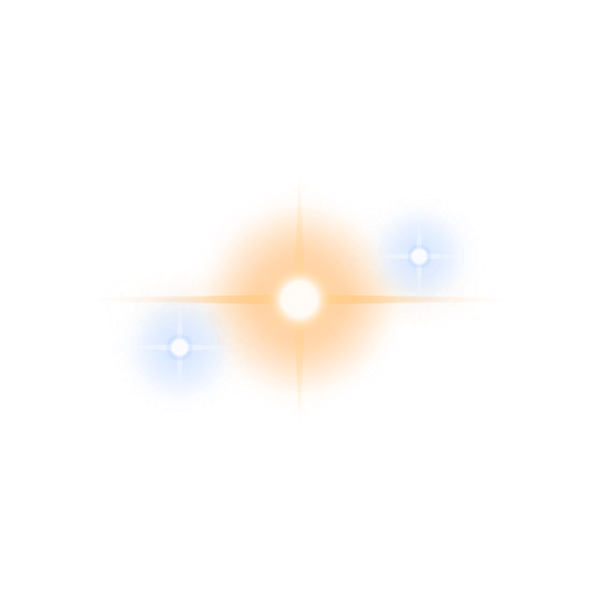
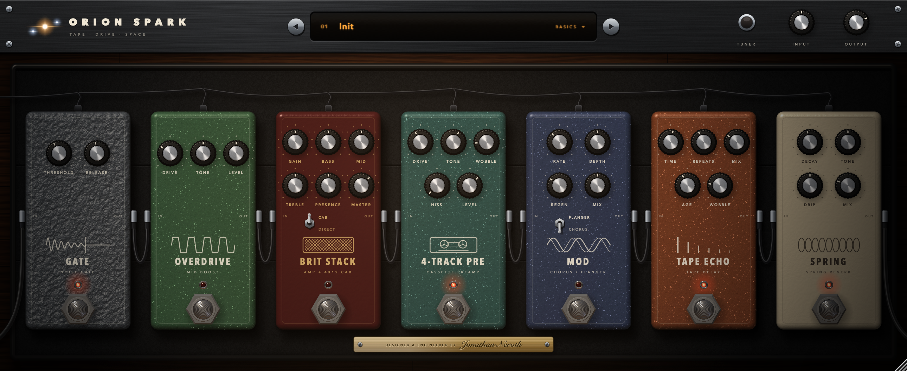

<p align="center">
  
</p>

<h1 align="center">Orion Spark</h1>

<p align="center"><em>Three stars in a row. One of them catches fire.</em></p>

<p align="center">
  
</p>

A personal guitar pedalboard plugin (AU / VST3 / Standalone) for macOS, built with JUCE.
Designed & engineered by Jonathan Neroth.

---

## Why "Orion Spark"?

Orion is the first constellation most of us learn to find: three bright stars in a perfect row, the hunter's
belt, hanging low over the treeline on clear winter nights. Up north in January it's there almost every
time you look up.

That's the whole idea. Three stars in a row is a signal chain: guitar, board, amp. The
spark is the moment in the middle where it _catches_:

- where **Gate** lets the first note through out of the silence,
- where **Overdrive** and **Brit Stack** tip a clean note into breakup,
- where the **4-Track Pre** stops being polite,
- where **Mod** makes the light shimmer,
- where **Tape Echo** brings a note back a little different every time,
- and where **Spring** keeps it glowing after you've stopped playing.

The logo is that night: Orion's belt, two cold blue stars and one amber spark in the middle. The real belt
stars are all blue supergiants, so the spark is the one bit of artistic licence.

_(Or so the story goes.)_

---

## The board

Chain: **Gate → Overdrive → Brit Stack → 4-Track Pre → Mod → Tape Echo → Spring**

| Pedal       | What it does                                                                            | Controls                                              |
| ----------- | --------------------------------------------------------------------------------------- | ----------------------------------------------------- |
| Gate        | Stereo-linked noise gate with hysteresis and hold                                       | Threshold, Release                                    |
| Overdrive   | Tube-Screamer-style mid-hump boost (4x oversampled)                                     | Drive, Tone, Level                                    |
| Brit Stack  | British high-gain amp-in-a-box: 3 tube-like stages, tone stack, power amp, 4x12 cab sim | Gain, Bass, Mid, Treble, Presence, Master, Cab/Direct |
| 4-Track Pre | Cassette 4-track preamp breakup, tape wobble, hiss                                      | Drive, Tone, Wobble, Hiss, Level                      |
| Mod         | Stereo chorus / flanger                                                                 | Rate, Depth, Regen, Mix, Chorus/Flanger               |
| Tape Echo   | Tape delay; repeats darken and saturate, time changes glide                             | Time, Repeats, Mix, Age, Wobble                       |
| Spring      | Two-spring tank reverb with dispersive "drip"                                           | Decay, Tone, Drip, Mix                                |

Each pedal has a footswitch. Echo and Spring keep ringing out when switched off (trails).
Double-click a knob to reset it. The window can be resized from its corner.

**Tuner:** the round **TUNER** button in the header mutes the output and turns the preset display into a
chromatic tuner (A4 = 440 Hz, down to drop A). It listens to the dry input before any pedal, so it reads the
string even with drives on. The LEDs are 5 cents apart; the centre one lights green within ±2 cents. Click the
display or the button again to switch it off. The tuner is never saved with a session and switches off when
the plugin window closes, so the plugin can't be left silent by accident.

**Presets:** click the display in the header (or use the arrows). Factory presets are tones "inspired by"
John Sykes, Mk.gee, 70s rock and metal rhythm players. The selected preset and any tweaks are saved with
your Ableton set.

The whole UI is drawn procedurally (`src/ui/Render.cpp`, `src/ui/Logo.cpp`), with no image assets: lit
enclosures, spun-metal knobs, chrome, cables, the walnut floor and the logo are all generated in code.
The images in `docs/` are renders of it.

## Build (Apple Silicon Mac)

Requirements: Command Line Tools (`xcode-select --install`) and CMake (`brew install cmake`).

```sh
cd orion-spark
cmake -B build -DCMAKE_BUILD_TYPE=Release
cmake --build build -j 8
```

The first configure downloads JUCE (≈ 1 minute, needs internet) and the first build takes a few minutes.

The build copies the plugins into place automatically:

- AU: `~/Library/Audio/Plug-Ins/Components/Orion Spark.component`
- VST3: `~/Library/Audio/Plug-Ins/VST3/Orion Spark.vst3`
- Standalone app: `build/OrionSpark_artefacts/Release/Standalone/Orion Spark.app`

In Ableton Live, open Settings → Plug-Ins, make sure Audio Units and/or VST3 system folders are enabled, and
rescan (exact labels vary between Live versions). It shows up under Plug-Ins → Jonathan Neroth → Orion Spark.
The AU is the one validated with Apple's `auval`, so try that first.

**Standalone app:** JUCE mutes audio input on first launch (to prevent feedback through laptop speakers).
Open Options → Audio/MIDI Settings, pick your interface, and untick "Mute audio input". Use headphones.

**Latency:** the oversampled pedals and the 4-Track Pre add about 3 ms in total (also when bypassed). It's
reported to the host, so recordings line up; you may feel it slightly when monitoring live.

## Tests

```sh
./build/OrionTests_artefacts/Release/OrionTests
auval -v aufx Orsk Nrth
```

`OrionTests` runs the real processor offline: silence, impulses and sweeps at 44.1/48/96 kHz with block
sizes 1–2048, every knob at max with full-scale noise (checks feedback can't run away), bypass transparency,
latency, loudness, every factory preset, random automation, state save/restore and CPU load.
`OrionTests --snapshot docs/screenshot.png` re-renders the screenshot and `docs/logo.png`.

## Adding a pedal

1. Subclass `orion::Pedal` (see `src/pedals/`), with parameter IDs prefixed by the pedal id.
2. Add it to `OrionAudioProcessor::createPedals()` and its `.cpp` to `ORION_CORE_SOURCES` in `CMakeLists.txt`.

Never rename an existing parameter ID; saved Ableton sets and presets depend on them.
